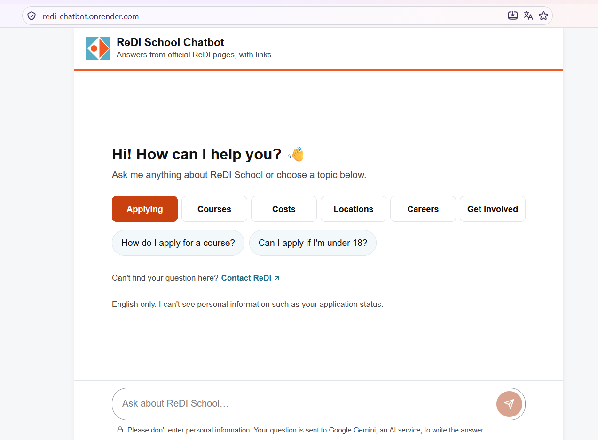

🇬🇧 [English](README.md) | 🇩🇪 **Deutsch**

# 🤖 ReDi-Chatbot

🌐 **Live ausprobieren:** [redi-chatbot.onrender.com](https://redi-chatbot.onrender.com), ohne
Installation. Die App läuft im kostenlosen Tarif von Render, der sie schlafen legt, wenn sie
niemand nutzt; beim ersten Aufruf kann die Seite deshalb etwa eine Minute zum Laden brauchen.



## 💬 Worum es geht

Ein Chatbot, der Fragen zur ReDI School klar beantwortet, auf Grundlage offizieller
ReDI-Informationen, und die Quellen verlinkt, die er dafür genutzt hat.

- **Für wen:** die breite Öffentlichkeit, zum Beispiel Menschen, die sich für einen Kurs
  interessieren, ehrenamtlich mitarbeiten oder ReDI kontaktieren möchten.
- **Welche Quellen:** ausschließlich die ReDI-Website und Dokumente von ReDI-Mitarbeitenden. Die
  zugelassenen Quellen stehen in `sources.md` (`data/sources.json` ist die Liste, die die
  Ingestion einliest).
- **Wenn die Quellen eine Frage nicht abdecken,** sagt der Chatbot das offen und verlinkt die
  Kontaktseite von ReDI, statt zu raten.
- **Sprache:** nur Englisch.

Wie alles Schritt für Schritt funktioniert, mit Diagrammen:
[docs/how_it_works.md](docs/how_it_works.md).

## 📋 Voraussetzungen

Du brauchst:

- **Python 3.14** (das `Dockerfile` nutzt `python:3.14.7-slim`; lokal am besten dieselbe Version)
- die Pakete aus `requirements-dev.txt` (werden im nächsten Schritt installiert)
- optional: einen **Google Gemini API-Key** für echte Antworten. Ohne Key läuft die App im
  Demo-Modus (siehe unten).

## 🚀 So startest du das Projekt

### ⚙️ 1. Einrichtung

```powershell
python -m venv .venv
.venv\Scripts\Activate.ps1
pip install -r requirements-dev.txt
```

### 🔄 2. Inhalte aktualisieren

Lädt die zugelassenen Quellen aus `data/sources.json` und speichert die Chunks in
`data/chunks.json`:

```powershell
python src/run_ingestion.py
```

Am Ende zeigt das Skript, welche Quellen sich seit dem letzten Lauf geändert haben. Der
vollständige Ablauf, um die Inhalte aktuell zu halten (wann aktualisieren, Antworten prüfen,
deployen), steht in [docs/update_content.md](docs/update_content.md).

### ▶️ 3. Chat-Seite starten

```powershell
python src/app.py
```

Für echte Antworten von Google Gemini setzt du vorher im selben Terminal deinen API-Key
(schreib ihn nie in eine Datei, die committet wird):

```powershell
$env:GEMINI_API_KEY = "your-key"
python src/app.py
```

Ohne `GEMINI_API_KEY` läuft die App im **Demo-Modus**: Suche und Quellenlinks sind echt, der
Antworttext ist aber ein Platzhalter, der ausdrücklich sagt, dass es keine echte Antwort ist.

## ✅ So erkennst du, dass es funktioniert

1. Öffne http://127.0.0.1:5000 im Browser.
2. Du siehst die Seite **„ReDI School Chatbot“** mit der Begrüßung **„Hi! How can I help
   you?“**, Themen-Tabs mit Beispielfragen und einem Eingabefeld („Ask about ReDI School…“).
3. Frag **„How do I apply?“**. Du solltest Folgendes bekommen:
   - eine Antwort (mit `GEMINI_API_KEY`) oder den Platzhalter des Demo-Modus (ohne Key)
   - einen Bereich **Sources** unter der Antwort mit Links zu ReDI-Seiten, zum Beispiel zur FAQ
4. Frag etwas, das nichts mit ReDI zu tun hat, zum Beispiel **„What is the weather
   tomorrow?“**. Der Chatbot sagt, dass er das aus seinen Quellen nicht beantworten kann, und
   zeigt einen Link zur Kontaktseite von ReDI.

Bekommt jede Frage die Meldung „temporarily unavailable“, fehlt `data/chunks.json`: Führe dann
zuerst die Ingestion aus (Schritt 2).

## 🚧 Was noch nicht geht

- **Demo-Modus** ohne `GEMINI_API_KEY`: kein echter Antworttext.
- **Stichwortsuche statt semantischer Suche:** Kleine Tippfehler werden korrigiert, aber eine
  Frage, die andere Wörter verwendet als die Seiten, kann sie trotzdem verfehlen. Bekannte
  Fälle: „which courses are they“ findet die Kursliste nicht, und „What is ReDI?“ findet die
  Seite „Our impact“ nicht. Details in `docs/task8_findings.md`.
- **Kein Gesprächsgedächtnis:** Jede Frage wird für sich beantwortet. Eine Nachfrage wie
  „which courses are they“ weiß also nicht, was vorher gefragt wurde.
- **Keine automatischen Updates:** Die Inhalte ändern sich nur, wenn du die Ingestion erneut
  ausführst ([docs/update_content.md](docs/update_content.md)).
- **Kein PDF-Reader:** Dokumente von ReDI-Mitarbeitenden können noch nicht eingelesen werden,
  nur Webseiten.
- **Nach dem MVP geplant:** unterschiedliche Antworten für Interessierte und aktuelle
  Teilnehmende, Nutzerfeedback, weitere Sprachen, Gesprächsgedächtnis und die Einbettung in
  andere Plattformen.
- **Öffentliche Render-URL:** Jede Besucherin und jeder Besucher kann 5 Fragen pro Minute
  stellen, und Geminis kostenloser Tarif erlaubt 15 pro Minute für alle zusammen; danach bittet
  die Seite um etwas Geduld.

Die technischen Einschränkungen stehen in
[docs/mvp_review.md](docs/mvp_review.md#known-limitations).

## 🧪 Echte Nutzerfragen auswerten (Task 8)

Schickt jede Frage aus `data/task8_questions.json` durch die Chat-API und schreibt die
Ergebnistabelle nach `docs/task8_results.md`:

```powershell
python src/run_evaluation.py
```

Mit gesetztem `GEMINI_API_KEY` kommen die Antworten von Gemini (ein Aufruf pro beantworteter
Frage); ohne Key lassen sich nur Suche, Quellen und Fallback beurteilen.

Das Ergebnis zeigt, wie viele **automated evaluation checks passed**, zuletzt „27 of 29“.
Diese Checks prüfen nur, ob die richtigen ReDI-Seiten gefunden wurden und ob themenfremde
Fragen den Fallback bekommen. Ob eine Antwort inhaltlich stimmt, wird nicht automatisch
geprüft: Dafür liest du die Antworten in der Ergebnistabelle.
Die Erkenntnisse aus jedem Lauf sind in `docs/task8_findings.md` zusammengefasst.

## ☁️ Auf Render deployen

Das `Dockerfile` startet die App mit gunicorn (siehe `specs/task9_deploy_render.md`). Auf Render:

1. Lege aus diesem GitHub-Repo einen **Web Service** an und wähle **Docker** als Sprache.
2. Füge unter **Environment** `GEMINI_API_KEY` mit deinem Key hinzu. Ohne Key läuft die App im
   Demo-Modus. Der Key gehört nie ins Repo oder ins `Dockerfile`.
3. Setze den **Health Check Path** auf `/`.

Nach einer erneuten Ingestion committest du `data/chunks.json`; Render baut dann ein neues
Image.

## 🔬 Tests ausführen

```powershell
python -m pytest
```

## 🗂️ Wo die Entscheidungen dokumentiert sind

- **`CLAUDE.md`:** der vereinbarte MVP-Umfang und die Reihenfolge der Tasks.
- **`docs/how_it_works.md`:** Diagramme zu Aufbau, Ingestion und Antwortablauf.
- **`sources.md`:** welche Quellen zugelassen sind und welche geprüft und ausgeschlossen wurden.
- **`specs/`:** eine Spec pro Task oder Fix, benannt nach dem Task, zum Beispiel
  `specs/task3_answer_grounding.md` (wie Antworten in den Quellen verankert sind),
  `specs/task5_citation_sourcing.md` (wie Quellenlinks angezeigt werden) und
  `specs/task9_deploy_render.md` (Deployment).
- **`docs/adr/`:** Architecture Decision Records für Entscheidungen mit Abwägungen:
  - `0001-ingestion-report-summary.md`
  - `0002-chat-interface-json-api.md`
- **`docs/task8_findings.md`:** was die Evaluation ergeben hat und in welcher Reihenfolge die
  nächsten Fixes kommen.
- **`docs/update_content.md`:** wie die Inhalte aktuell bleiben (Task 10).
- **`docs/mvp_review.md`:** was die Reviews nach Task 10 ergeben und geändert haben, und die
  bekannten Einschränkungen.

Die Dokumente im Repo sind auf Englisch.

## 🤝 KI-Zusammenarbeit & mein Beitrag

Ich habe dieses Projekt mit Claude Code, dem KI-Coding-Assistenten von Anthropic, als
Entwicklungspartner umgesetzt. Ich war verantwortlich für die Projektausrichtung, die
Anforderungen, die technischen Entscheidungen, die Qualitätssicherung und die Ergebnisse; die
KI hat mich bei der Umsetzung unterstützt.

### Was ich gemacht habe

- **Projektumfang und Anforderungen festgelegt:** Zielgruppe, zugelassene Quellen, Sprache und
  die Regeln, wie Antworten in den Quellen verankert sein müssen.
- **Technische Entscheidungen getroffen:** verschiedene Ansätze bewertet, ihre Vor- und
  Nachteile verglichen und auf Basis von Testergebnissen passende Lösungen ausgewählt.
- **Den Entwicklungsablauf etabliert:** Spezifikation zuerst, nummerierte Akzeptanzkriterien,
  testgetriebene Entwicklung und getrennte Pull Requests.
- **Den GitHub-Workflow gesteuert:** jeden Pull Request geprüft, freigegeben und gemergt.
- **Den Chatbot getestet und ausgewertet:** Evaluationen durchgeführt, die deployte Anwendung
  getestet, Probleme erkannt und Verbesserungen priorisiert.
- **Den MVP-Umfang gesteuert:** entschieden, welche Befunde behoben und welche als bekannte
  Einschränkungen dokumentiert werden.

### Was die KI gemacht hat

- Technische Ansätze vorgeschlagen und ihre Vor- und Nachteile erklärt.
- Den Großteil von Code, Tests, Spezifikationen und Dokumentation als Entwurf für meine Prüfung
  geschrieben.
- Beim Debugging, bei Code-Reviews und bei der Performance-Optimierung unterstützt.
- Freigegebene Tests und Messungen ausgeführt und die Ergebnisse berichtet, auch Fehlschläge.

### Transparenz & Nachvollziehbarkeit

Technische Entscheidungen, Akzeptanzkriterien und Evaluationsergebnisse sind in `specs/`,
`docs/adr/` und `docs/task8_findings.md` dokumentiert. Alle Änderungen lassen sich über die
Pull Requests auf GitHub nachvollziehen.

Dieses Projekt zeigt meinen Ansatz für KI-gestützte Softwareentwicklung: menschliche
Entscheidungen, kritische Bewertung und strukturierte Entwicklungspraktiken, kombiniert mit
KI-gestützter Umsetzung.
