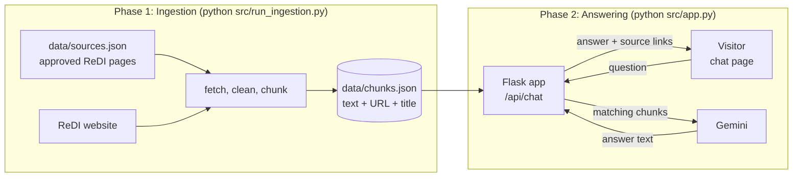
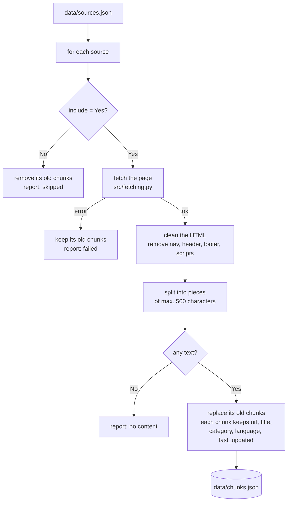
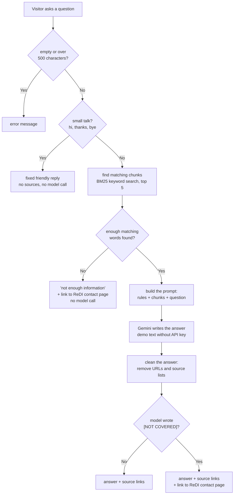

# How the ReDI Chatbot works

The chatbot works in two separate phases:

1. **Ingestion** (run by hand): fetch the approved ReDI pages and save them as small text
   pieces ("chunks"), each with its source URL.
2. **Answering** (every time a visitor asks): find the chunks that match the question and let
   the model answer only from them.

GitHub shows the diagrams below as pictures.

## 1. Overview

The model never sees the internet. It only sees the chunks the app gives it, which is how
answers stay grounded in ReDI's own information.

## 2. Ingestion: from a ReDI page to chunks

A failed fetch keeps the old chunks, so a short outage of the ReDI website loses nothing.

## 3. Answering a question

The source links below the answer always come from the chunks' metadata, never from the
model. That is why the code removes every URL the model writes: it could be invented.

## Where each step lives

| Step | File |
|---|---|
| Run the ingestion | `src/run_ingestion.py` |
| Fetch a page | `src/fetching.py` |
| Clean and chunk | `src/ingestion.py` |
| Web page and API | `src/app.py`, `templates/chat.html`, `static/js/chat.js` |
| Search, prompt, cleaning the answer | `src/grounding.py` |
| Gemini connection, demo mode | `src/llm.py` |
| Source links | `src/citations.py` |
