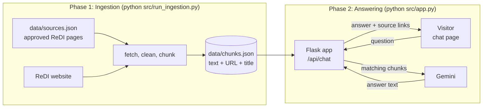
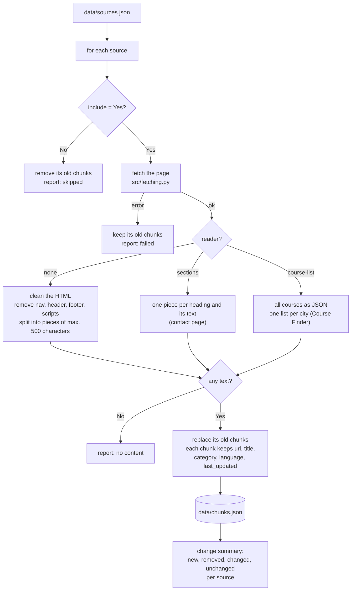
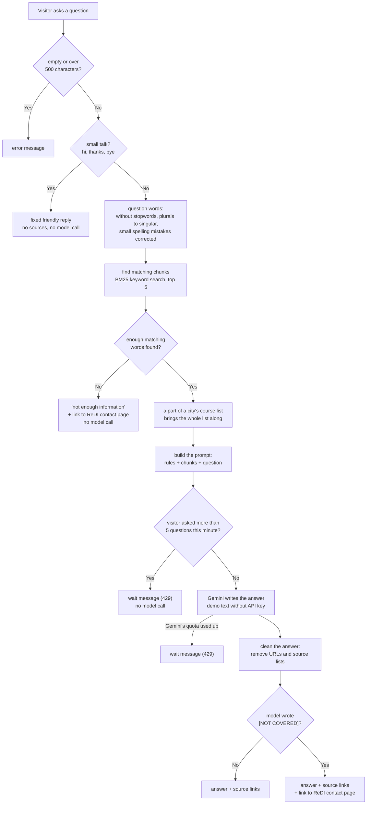

# How the ReDI Chatbot works

The chatbot works in two separate phases:

1. **Ingestion** (run by hand): fetch the approved ReDI pages and save them as small text
   pieces ("chunks"), each with its source URL.
2. **Answering** (every time a visitor asks): find the chunks that match the question and let
   the model answer only from them.

GitHub shows the diagrams below as pictures.

## 1. Overview

The model never sees the internet. It only sees the chunks the app gives it, which is how
answers stay grounded in ReDI's own information.

## 2. Ingestion: from a ReDI page to chunks

A failed fetch keeps the old chunks, so a short outage of the ReDI website loses nothing.

Most pages are cut every 500 characters. Two pages are read differently, set by `"reader"`
in `data/sources.json`:

- **`sections`** (the contact page): each heading stays with its text, so "Munich" and the
  Munich street address end up in the same chunk.
- **`course-list`** (the Course Finder): the page only shows 20 courses, so all courses are
  fetched as JSON and saved as one list per city ("Which courses are there in Munich?").

At the end, the script prints which sources changed since the last run. How to update the
content step by step: [update_content.md](update_content.md).

## 3. Answering a question

The source links below the answer always come from the chunks' metadata, never from the
model. That is why the code removes every URL the model writes: it could be invented.

Some details of the search (`src/grounding.py`):

- **Spelling mistakes:** a word that is in no chunk is compared with the chunks' own words.
  One typo is corrected ("aply" → "apply"), two typos only in words of 8 to 15 letters
  ("voulenteer" → "volunteer"). A short typo of a stopword ("du" → "do") is dropped.
- **The gate:** a chunk must contain at least half of the question's words, and at least two
  of them, so one accidental word ("Write me a poem.") isn't enough.
- **Synonyms** (`SYNONYMS`) only change the ranking: a question about a "job" also scores
  chunks that say "career".

**Limits that protect the free Gemini quota** (15 requests per minute for everyone together):
each visitor can ask 5 questions per minute that reach Gemini (`src/rate_limit.py`); small talk
and questions without matching chunks don't count. When Gemini's quota is used up anyway, the
visitor gets a wait message instead of an error.

On the page, `static/js/format.js` splits the answer's lines into paragraphs and lists, and
`static/js/chat.js` builds the page elements from them with `textContent`, never with
`innerHTML`, so text from the model can't add HTML to the page.

## Where each step lives

| Step | File |
|---|---|
| Run the ingestion, change summary | `src/run_ingestion.py` |
| Fetch a page or the Course Finder's JSON | `src/fetching.py` |
| Clean and chunk, the readers | `src/ingestion.py` |
| Web page and API | `src/app.py`, `templates/chat.html`, `static/js/chat.js` |
| Answer as paragraphs and lists | `static/js/format.js` |
| Limit per visitor | `src/rate_limit.py` |
| Search, spelling, prompt, cleaning the answer | `src/grounding.py` |
| Gemini connection, demo mode | `src/llm.py` |
| Source links | `src/citations.py` |
| Task 8 evaluation | `src/run_evaluation.py` |
